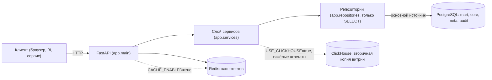

# Архитектура MOEX-ISS API

## Схема решения и поток данных

Поток запроса: клиент зовёт `/api/v1/...`, слой API валидирует параметры,
слой сервисов считает производные метрики, репозитории читают строки из
PostgreSQL. Опциональные ветки подключаются флагами: ClickHouse ускоряет
тяжёлые агрегаты (`/summary`, `/ranking`), Redis кэширует успешные ответы.

## Слои приложения

- **api (`app/api`)**: роутеры FastAPI версии v1, зависимости пагинации и
  периода, единая проверка `X-API-Key`. Здесь только разбор запроса, вызов
  сервиса и упаковка ответа в конверт `Page[T]`.
- **schemas (`app/schemas`)**: Pydantic-модели ответов и общих конвертов
  (`Page`, `Order`, `ErrorResponse`). Описывают контракт наружу.
- **services (`app/services`)**: бизнес-логика и чистая математика
  (доходность, волатильность, просадка, агрегаты рейтинга, выбор источника
  аналитики). Каталог `dates` конвертирует `date_key` в дату и обратно.
- **repositories (`app.repositories`)**: SQL-запросы к PostgreSQL, только
  `SELECT`. Здесь же ClickHouse-ветка (`ch_analytics.py`) для тяжёлой
  аналитики. Репозитории не пишут, `commit` и `rollback` не вызываются.
- **models (`app/models`)**: read-only модели SQLAlchemy 2.0 (DeclarativeBase,
  `Mapped` / `mapped_column`), ровно по колонкам слепка `db/seed/01_seed.sql`.

## Как выбирается источник данных

Выбор источника сосредоточен в одном месте: `app/services/analytics.py`.

- При `USE_CLICKHOUSE=false` (по умолчанию) тяжёлые агрегаты читаются из
  PostgreSQL.
- При `USE_CLICKHOUSE=true` те же агрегаты читаются из ClickHouse.
- Математику источники не дублируют: обе ветки отдают одни и те же сырые
  строки витрин в общие функции `app/services/returns.py` и
  `app/services/ranking.py`, поэтому результаты совпадают по построению.
- Если флаг поднят, а ClickHouse недоступен, эндпоинт отвечает HTTP 503 в
  едином формате ошибок. Молчаливого отката на PostgreSQL нет.

## Почему PostgreSQL это источник истины

- Витрины `mart` / `core` считает мини-DWH (Airflow + PostgreSQL), именно там
  данные появляются и обновляются.
- ClickHouse это вторичная копия, которую наполняет `scripts/ch_load.py`
  вручную; она нужна только для скорости тяжёлых агрегатов.
- Любая правка данных идёт в PostgreSQL, а ClickHouse переливается повторным
  запуском загрузчика.

## Кэш и сквозные механизмы

- **Redis-кэш** (`app/cache.py`): при `CACHE_ENABLED=true` успешные GET-ответы
  под `/api/v1` кэшируются на `CACHE_TTL_SECONDS`, в ответ добавляется
  заголовок `X-Cache: HIT` или `MISS`. Кэш необязателен: если Redis недоступен,
  приложение работает без кэша и пишет одно предупреждение в лог.
- **Идентификатор запроса**: middleware ставит `X-Request-ID` в каждый ответ;
  то же значение попадает в тело ошибки.
- **Ограничение частоты**: скользящее окно в памяти процесса на `/api/v1/*`,
  ответ 429 с `Retry-After`.
- **Единый формат ошибок**: `{"error": {"code", "message", "details", "request_id"}}`.
